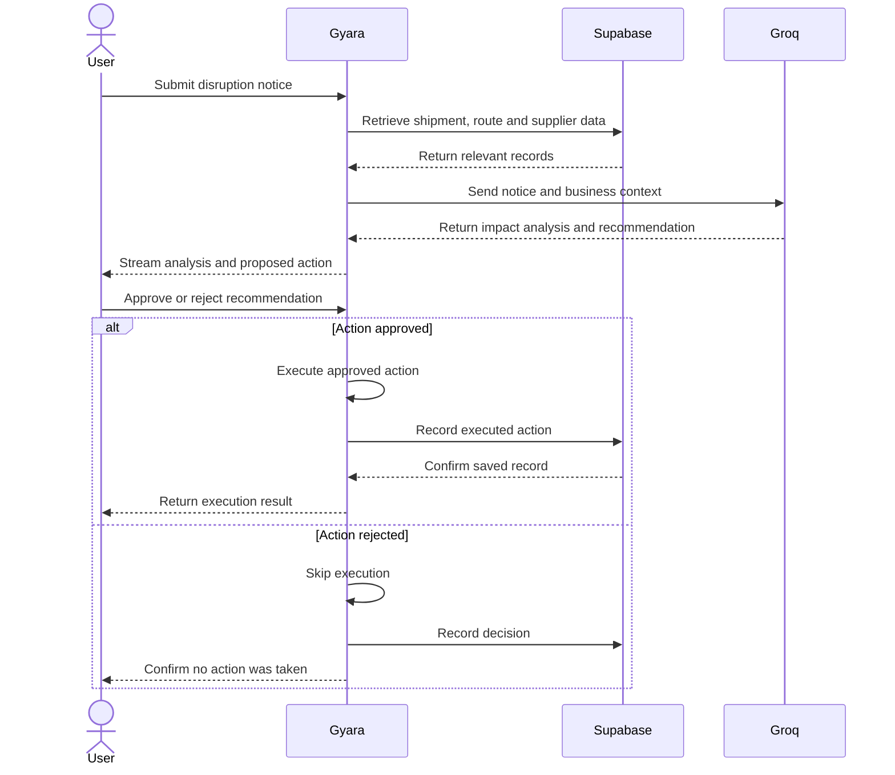

# Gyara
Gyara is an AI-powered supply chain operations agent that monitors disruption notices, evaluates their impact on your business and recommends corrective actions for human approval.

It focuses on two types of disruptions:
- **Shipment Delays:** Carrier delays, customs holds, and warehouse backlogs.
- **External Events:** Floods, road closures, and port disruptions that affect shipment routes.

## Features
- **Disruption Analysis:** Evaluates incoming notices to determine how they affect business operations.
- **Business Data Retrieval:** Looks up relevant shipment, route, and supplier records from the database.
- **AI-Powered Recommendations:** Uses Groq to assess disruptions and propose specific corrective actions.
- **Human-in-the-Loop Approval:** Requires approval before executing actions that could incur costs or change delivery arrangements.
- **Action Execution and Audit Trail:** Executes approved actions and records what happened.
- **Streaming Responses:** Uses Server-Sent Events (SSE) to stream agent updates to the interface.

## System Architecture
Gyara processes disruption notices through a sequence of data retrieval, AI reasoning, human approval, and action execution.



## Requirements

- Node.js 
- Supabase project
- Groq account and API key

## Getting Started
### Clone the Repository

```bash
git clone https://github.com/Udehlee/Gyara.git
cd gyara
pnpm install
```

### Configure Environment Variables
Create a `.env` file in the project root:

```env
GROQ_API_KEY=your_groq_api_key

NEXT_PUBLIC_SUPABASE_URL=https://your-project-ref.supabase.co
NEXT_PUBLIC_SUPABASE_PUBLISHABLE_KEY=your_supabase_publishable_key
```

Get your API key and project credentials from:

- [Groq Console](https://console.groq.com/)
- [Supabase Dashboard](https://supabase.com/dashboard)

### Set Up the Database
-  Open your Supabase project and navigate to the SQL Editor.
-  Run the SQL in [`supabase/schema.sql`](supabase/schema.sql) to create the required tables, enable Row Level Security (RLS), and configure permissions.
-  Run [`supabase/seed.sql`](supabase/seed.sql) to populate the database with sample shipment, route, and supplier records.

### Run the Application
```bash
pnpm dev
```

Open [http://localhost:3000](http://localhost:3000) in your browser and submit a disruption notice to get started.

Run the test:
```bash
pnpm test
```
The project also uses Vitest for testing and CI for automated checks.
